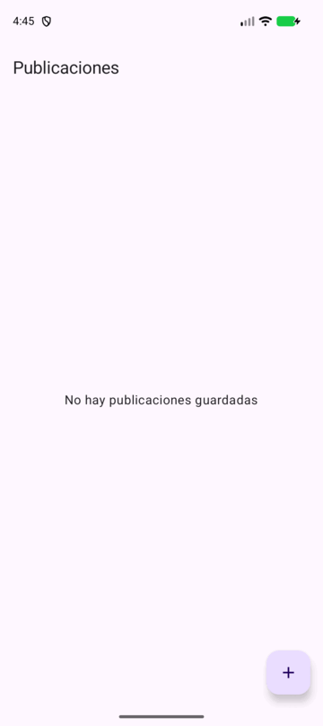

# MiniProyecto03 — Publicaciones con Room y Jetpack Compose

Aplicación Android (Kotlin) que implementa la arquitectura MVVM y persiste publicaciones
usando **Room**. La UI está construida con **Jetpack Compose** e integra la cámara y la
galería del dispositivo con gestión de permisos.

## Características

- Arquitectura MVVM (ViewModel + Repository + DAO).
- Room Persistence Library: entidad `Publicacion` (id, titulo, descripcion, fotoUri, fecha).
- Formulario de alta (Título, Descripción, Fecha generada/seleccionable).
- Listado de publicaciones con foto y datos.
- Captura de foto con la cámara y selección desde la galería.
- Gestión de permisos en tiempo de ejecución (cámara).

## Estructura

- `data/local`: entidad, DAO y base de datos Room.
- `data/repository`: repositorio de publicaciones.
- `ui/viewmodel`: `PublicacionViewModel`.
- `ui/screens`: `FormularioScreen`, `ListaScreen`.
- `ui/theme`: tema Compose.

## Demo



## Build

```bash
./gradlew assembleDebug
```

Repositorio: https://github.com/Adrianthropic/MiniProyecto03